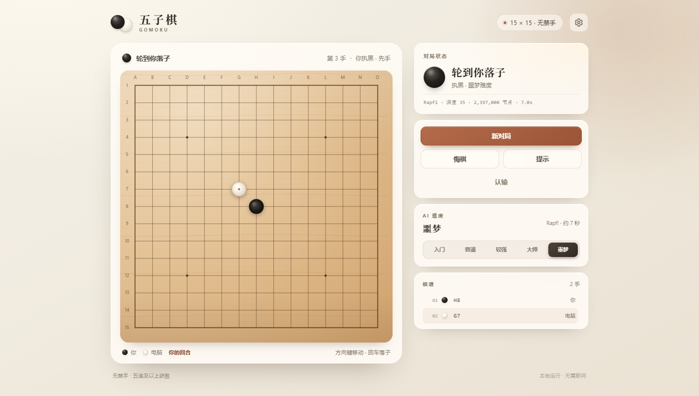

# 五子棋 · 人机对战

一个零依赖、离线可玩的 15×15 无禁手五子棋。界面采用暖木棋盘与米白纸感配色，内置四档 AI，另有由开源 **Rapfi** WebAssembly 引擎驱动的「噩梦」难度。



## 直接开始

双击 `index.html` 即可在浏览器中游玩，不需要安装 Node、Python 或任何第三方库。

- 玩家默认执黑先手。
- 点击「新对局」可以切换执黑/执白与难度。
- 选择白棋时，电脑执黑先行。
- 对局会自动保存在浏览器本地，刷新或下次打开会恢复上一局。

五档难度都在浏览器本地运行。第一次选择「噩梦」时，页面会加载内置的 Rapfi WebAssembly 引擎（约 1.2 MB）；之后每步思考约 7 秒，期间界面不会卡住。

## 规则

- 15×15 棋盘，双方均无禁手。
- 横、竖、斜任意方向连成 **5 子及以上**即获胜，长连同样算赢。
- 棋盘下满且无人获胜时判和棋。
- 黑棋固定先手。

## 功能

- 人机对战，可切换执黑/执白。
- 五档难度：入门、普通、较强、大师、噩梦。
- 悔棋（一次撤回玩家与电脑各一手）、认输、再来一局。
- 提示：让 AI 从玩家视角推荐一个落点。
- 棋谱记录、最后一手标记、获胜连线与获胜棋子高亮。
- 落子动画、音效、坐标、手数显示开关。
- 桌面端与移动端自适应；移动端支持滑动页面，不会误落子。
- 本地保存设置与未完成对局。
- 键盘操作：方向键移动，回车/空格落子；`Ctrl+Z` / `Cmd+Z` 悔棋。

## 难度

| 难度 | 单步时间 | 实现 |
| --- | --- | --- |
| 入门 | < 1 秒 | 内置 AI，深度 2，带随机性 |
| 普通 | 约 1 秒 | 内置 AI，深度 4 |
| 较强 | 约 3 秒 | 内置 AI，深度 6 |
| 大师 | 约 6 秒 | 内置 AI，深度 10 |
| 噩梦 | 约 7 秒 | Rapfi WebAssembly，内置经典评估模型 |

噩梦模式每步都会用当前棋盘重新初始化 Rapfi，因此悔棋、切换先后手、继续保存的旧对局都不会让引擎保留上一局的状态。

## AI 设计

### 内置 AI

内置 AI 位于 `src/engine.js`，核心思路：

1. **棋型评估**：为每条横、竖、斜线维护五格窗口分数（成五、活四、冲四、活三、眠三等），落子时只增量更新经过该点的四条线。
2. **候选点分析**：对每个空点预计算 9 格局部棋型，得到进攻分与防守分，既用于着法排序，也用于识别立即成五与必须堵五的点。
3. **Alpha-Beta 搜索**：迭代加深、主变例搜索（PVS）、置换表（Zobrist 哈希）、杀手着法、历史启发和候选点裁剪。
4. **时间控制**：按难度设置思考时间上限，在 Web Worker 中计算，避免阻塞界面；浏览器限制 Worker 时自动降级到主线程兼容模式。
5. **胜负优先**：先检查立即成五；若对方下一手能成五，则只考虑堵点，搜索中每一步也优先处理必胜/必防着法。

内置 AI 的目标是稳定击败只看两三步、不熟悉复杂定式的普通爱好者。

### 噩梦：Rapfi WebAssembly

- 引擎：[Rapfi](https://github.com/dhbloo/rapfi)，Gomocup 冠军级开源五子棋/连珠引擎。
- 构建：单线程 WebAssembly SIMD，经典评估模型，内置在 `index.html` 中，不需要联网或本地服务。
- 通信：页面把 225 格棋盘和电脑棋色交给 Worker，Worker 通过 Gomocup / piskvork 文本协议驱动 Rapfi，再把落点、深度、节点数和耗时返回界面。
- 时间：`INFO timeout_turn 7000`，保持约 7 秒的思考时间。
- 计算在独立 Worker 中进行；关闭页面、重开对局或悔棋会终止当前搜索。
- 引擎加载失败、计算超时或返回非法落点时，界面会说明原因，并提供「重试本手」或「改用大师 AI」。

## 项目结构

```text
gomoku/
├─ index.html              # 构建产物：单文件应用，双击即玩
├─ preview.png
├─ build.js                # 把 CSS、源码、Rapfi Wasm 内联进 index.html
├─ src/
│  ├─ template.html        # HTML 模板
│  ├─ styles.css           # 界面样式
│  ├─ engine.js            # 内置 AI 与规则
│  ├─ worker.js            # 内置 AI 的 Worker 通信层
│  ├─ rapfi-worker.js      # Rapfi Wasm Worker 包装与协议解析
│  └─ app.js               # 棋盘绘制、交互、对局流程、音效
├─ vendor/
│  └─ rapfi/               # Rapfi Wasm、经典模型、许可证与构建说明
└─ tests/
   ├─ test-engine.js       # 规则与内置 AI 战术自测
   ├─ test-ui.js           # Chrome 界面冒烟测试
   ├─ test-nightmare-wasm.js # Rapfi 端到端测试
   ├─ test-nightmare-unsupported.js # Worker 不可用时的降级提示
   ├─ test-ai-strength.js
   ├─ test-match.js
   └─ measure-ui.js        # 移动端尺寸检查
```

## 开发

修改 `src/` 下的源码后重新生成单文件：

```bash
node build.js
```

构建会读取 `vendor/rapfi/` 下的 `rapfi.js`、`rapfi.wasm` 和 `rapfi.data`，把引擎和经典模型一起内联。构建后的 `index.html` 约 1.8 MB。

运行规则与战术测试：

```bash
node tests/test-engine.js
```

运行界面测试（需要本机 Chrome，默认路径为 `C:\Program Files\Google\Chrome\Application\chrome.exe`）：

```bash
node tests/test-ui.js
node tests/test-nightmare-wasm.js
node tests/test-nightmare-unsupported.js
```

测试脚本只使用 Node 内置模块和 DevTools Protocol，不需要安装 npm 依赖。

## 引擎许可

Rapfi 以 **GNU GPL v3** 发布，Wasm 构建来自
[ningh-o/engine-builds](https://github.com/ningh-o/engine-builds/releases/tag/rapfi-3c94c2a)，
上游源码固定于 `dhbloo/rapfi@3c94c2a976f24a0dd1c5517623e9ab6fffe66bd7`。
完整的构建配方、补丁、文件哈希和源码下载地址见
[`vendor/rapfi/SOURCE.md`](vendor/rapfi/SOURCE.md) 与
[`vendor/rapfi/BUILD.md`](vendor/rapfi/BUILD.md)。

Rapfi 作为独立的 WebAssembly 程序，通过 Gomocup 文本协议与本应用通信；应用自身代码不链接 Rapfi 的 C++ 源码。若公开分发本项目的构建产物，请同时保留 `vendor/rapfi/` 下的许可证与源码说明，或提供等价的源码获取方式。
